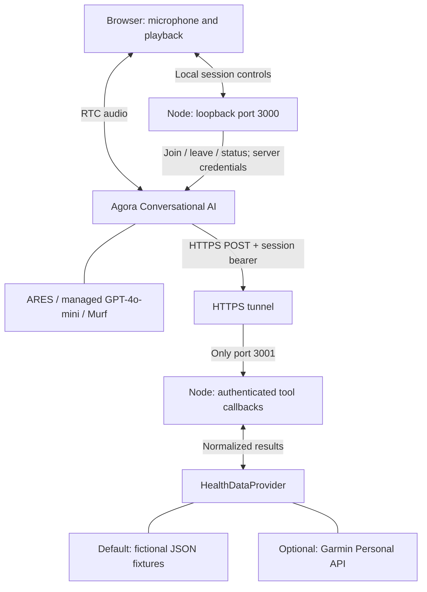

# Agora Health Voice

Build a local voice assistant that answers questions about sleep, daily heart rate, steps, distance and recent activities using authenticated tool calls. This TypeScript recipe connects a browser to Agora Conversational AI, then routes measurement requests through a small, reusable health-data provider contract.

The default provider reads fictional fixtures: **no Garmin account, private health credentials or real health data are needed**. Garmin Personal API is the first live reference integration. Provider independence applies to health data; the voice stack is currently configured for Agora RTC, ARES speech recognition, Agora-managed GPT-4o-mini and Murf speech synthesis.

## Architecture



One conversational interface uses one configured health-data provider at a time; the synthetic and Garmin adapters share the same tools and browser.

One Node process binds two listeners on `127.0.0.1`. Port **3000** serves the browser and local Start/Stop controls; port **3001** serves tool callbacks. Tunnel only **3001**. The callback listener returns `404` for the browser and session-control routes, and `401` for tool requests without a valid session bearer.

Implementation map: [browser](src/browser/main.ts), [local server and callbacks](src/server.ts), [Agora gateway](src/agora.ts), [tool schemas and normalization](src/tools.ts), [provider contract](src/providers/types.ts).

## Prerequisites and clone

Use Node.js **24 or later**, npm, Git and a modern browser. Local setup was assessed on macOS; other platforms have not been validated here. Voice additionally requires microphone permission, internet access, an Agora project with RTC token authentication and Conversational AI Main v2 access, Murf access, and an HTTPS tunnel utility.

```sh
git clone https://github.com/rangaj/agora-health-voice.git
cd agora-health-voice
npm ci
cp .env.example .env
npm start
```

The repository is currently private: cloning requires authorized GitHub access. A public material link must be arranged separately before submission; these instructions do not imply public availability.

Open [http://localhost:3000](http://localhost:3000). Keep `HEALTH_DATA_PROVIDER=synthetic`. With all six voice settings blank, the page displays the synthetic indicator and setup state, with Start disabled. This is a credential-free setup preview, not an offline spoken conversation. `npm start` builds the application before starting the server.

## Enable synthetic voice

Keep credentials in the ignored `.env` file, on the server. The current configuration validator requires all six entries below when enabling voice:

| Setting | Current implementation |
|---|---|
| `AGORA_APP_ID` | Project identifier; also used by the browser to join RTC |
| `AGORA_APP_CERTIFICATE` | Server-only secret used to generate RTC and Agora control tokens |
| `AGORA_CUSTOMER_ID` | Legacy configuration field: required to be nonempty by startup validation, but unused by the current gateway |
| `AGORA_CUSTOMER_SECRET` | Legacy configuration field: required to be nonempty by startup validation, but unused by the current gateway |
| `MURF_API_KEY` | Server-side BYOK credential supplied to Agora for Murf synthesis |
| `TOOL_CALLBACK_ORIGIN` | Public HTTPS tunnel origin, without a path, query or embedded credentials |

The gateway authenticates control requests using `Authorization: agora token=...`, generated from the App ID and App Certificate. It does **not** use Customer ID/Secret for Basic authentication. Leave the legacy fields present to satisfy the existing validator; the application does not consume their values for authentication. No separate OpenAI key is configured: GPT-4o-mini uses Agora-managed credentials. Account access and service availability must be confirmed for your own Agora project.

1. Configure the voice entries locally. Do not paste credentials into source files, browser code, issue submissions or logs.
2. In another terminal, start an HTTPS tunnel to the callback listener. For [Cloudflare Quick Tunnels](https://developers.cloudflare.com/tunnel/get-started/quick-tunnels/):

   ```sh
   cloudflared tunnel --url http://127.0.0.1:3001
   ```

3. Set `TOOL_CALLBACK_ORIGIN` to the printed HTTPS origin. Restart `npm start` and reload the page. A new temporary tunnel normally has a different URL.
4. Select **Start**, allow microphone access and ask a question. A live session can incur Agora or Murf charges even with fictional data. If playback is blocked, select **Enable audio**.

See [Agora's join reference](https://docs.agora.io/en/api-reference/api-ref/conversational-ai/join) for the service API. Runtime configuration is in [src/agora.ts](src/agora.ts); this documentation update does not change it.

## Tool calling and fixture demonstration

The model is instructed to call a tool for measurements, speak only returned values, preserve dates and explain missing data. Each synchronous callback uses a random per-session bearer and a five-second timeout. Inputs are validated before provider access; operational provider errors become `unavailable`, rather than fabricated measurements.

| Tool | Callback | Input |
|---|---|---|
| `getSleep` | `POST /tools/sleep` | `date`: `lastNight`, `today`, `yesterday` or exact `YYYY-MM-DD` |
| `getDailyHeartRate` | `POST /tools/heart-rate` | `date`: `today`, `yesterday` or exact date |
| `getDailyMovement` | `POST /tools/movement` | Same date input |
| `getRecentActivities` | `POST /tools/activities` | Integer `limit`, from 1 to 5 |

The [fictional fixture](fixtures/synthetic-health.json) anchors relative dates to **2025-02-14**, regardless of the actual day. The following are expected fixture answers, not a record of live spoken tests:

| Ask | Expected data |
|---|---|
| How did I sleep last night? | 7 hours 24 minutes on February 14, 2025 |
| What was my resting heart rate yesterday? | 56 bpm on February 13, 2025 |
| How many steps did I take yesterday, and how far did I go? | 8,240 steps and 5.91 km on February 13, 2025 |
| What were my last three activities? | Run, strength training and walk, newest first |
| What were my heart-rate readings on February 12, 2025? | 59 bpm resting; minimum and maximum missing |

Provider results use seconds, metres and bpm; the model may convert them for speech. Missing, unsupported and numeric zero remain distinct. See the [provider guide](docs/providers.md) to implement another source without changing browser behavior or tool schemas. `custom` currently selects the included Garmin adapter; arbitrary adapters are not loaded as plugins.

## Stop and session lifetime

Select **Stop** to close the microphone, leave RTC and request remote agent cleanup. The server revokes callback access immediately and checks for terminal remote status (`STOPPED` or `FAILED`); an inconclusive leave response is not treated as proof of shutdown. The UI supports retrying Stop when confirmation fails.

The browser and local server schedule cleanup at **three minutes from session creation**, including startup time. RTC credentials have a nominal 210-second lifetime. The join request also sets Agora's **30-second idle timeout**, which provides service-side idle cleanup after the participant leaves. These mechanisms are distinct: token expiry or a local timer is not proof that a remote agent has stopped.

**No remote maximum-duration parameter is sent in the current join request.** Some existing fallback messages refer to an Agora duration limit or waiting for expiry; they do not establish a remotely enforced three-minute cap. If cleanup cannot be confirmed, retry Stop and verify remote status through Agora's supported controls. Abrupt process termination can prevent local cleanup.

After the demonstration, stop the tunnel and Node server with Control-C in their respective terminals. Graceful server shutdown attempts remote cleanup.

## Validation and evidence

These commands validate the implementation without a live session:

```sh
npm run check
npm test
```

`npm run check` performs TypeScript checking without emitting files. `npm test` builds into `dist/` and runs Node tests; it does not load `.env`. Agora requests are mocked, and Garmin tests inject fictional credentials, responses and clocks instead of accessing the real key or API. Credential-file tests create and remove temporary files.

| Existing coverage | Scope |
|---|---|
| [Recipe tests](tests/recipe.test.mjs) | Fixture answers; dates, partial data and zero; invalid startup configuration; Agora payload structure; callback isolation/authentication/revocation; local expiry and lost-start recovery; stop confirmation; sanitized diagnostics; basic and single-tool modes |
| [Garmin tests](tests/garmin.test.mjs) | Credential-file permissions; token sharing, expiry and renewal; normalized measurements; missing data; local dates; pagination; malformed/oversized responses; request deadlines; shared tool contracts |
| [Secret-guard tests](scripts/test_secret_guard.py) | Temporary Git repositories exercise staged/history scanning, removed secrets, tags, multiple ref updates and scanner failure; separate from `npm test` and requires Gitleaks |

Evidence recorded for recipe preparation on **10 November 2026**:

- Final offline pre-commit review: `npm run check` passed; `npm test` passed **32/32 tests** (19 recipe tests and 13 Garmin tests), with zero failures, skips or cancellations. Service requests were mocked. The separate secret-guard self-test passed all 11 reported checks in temporary repositories.
- **Owner-confirmed live result:** a successful end-to-end spoken steps query used real Garmin data through Agora Conversational AI. The owner independently verified the returned step count against Garmin Connect. The live test was not repeated during this documentation update. The exact prompt, test date, measurement date, numeric result and session artifact are not recorded here; none is inferred.
- That single spoken-steps result does not establish live sleep, heart-rate, distance or activity coverage, nor an end-to-end synthetic voice test. Mocked payload tests do not establish current service acceptance or speech accuracy.
- No live voice sessions or Garmin API calls were performed for this documentation update. The offline results above do not add any live-service validation.

For optional connection diagnosis, `VOICE_MODE=basic npm start` uses the same RTC/ARES/model/Murf stack without tools. `VOICE_MODE=single-tool npm start` tests one authenticated callback returning a fixed fictional count of 1,234. Both modes still use live voice services and require the existing voice configuration; neither verifies the four health tools. Default `VOICE_MODE=health` enables the health recipe. Optional `HEALTH_DEBUG=true` logs fixed callback-stage labels and status, excluding arguments, measurements and credentials.

## Limitations, privacy and publication

This is a local, single-session demonstration, not a multi-user health service. The prompt prohibits diagnoses or treatment advice; that instruction is not a guarantee of model behavior. No clinical accuracy or compliance certification is claimed. Daily heart rate is a summary, movement distance is separate from activity distance, and sleep supports duration only.

Synthetic operation needs no health credentials. Choosing Garmin exposes normalized real measurements to the conversational stack; audio, tool results and spoken output pass through the applicable Agora/model/Murf services, and callback traffic crosses the tunnel provider. Service privacy/retention terms still apply. The code requests `opt_out: true`; this is not a promise of zero retention across providers. Server diagnostics suppress secrets and measurement values. Do not publish personal data or session artifacts without review.

Garmin's cold authentication can exceed the tool's five-second timeout even when a direct provider operation succeeds. See [provider limits](docs/providers.md) before interpreting live availability.

The repository remains private. MIT is the selected license, subject to Agora internal approval. The standard [LICENSE](LICENSE) is prepared with the proposed notice `Copyright (c) 2026 Agora, Inc.`; it is **pending confirmation of ownership and publication authorization**, not an established legal determination or an authorized public release. Read the [license review status](docs/license-proposal.md) before using or distributing the draft. Before submission:

- Confirm Agora ownership, the proposed copyright notice and internal MIT/publication approval. Confirm public author/contributor credit separately from copyright ownership.
- The [refreshed security audit](docs/git-secret-protection.md) passed the current working-file and complete local-history scans. Recheck any later changes before publication; hooks are local and must be installed in each clone.
- Arrange at least one reviewed public material URL under separate publication authorization. The [Agora submission form](https://github.com/AgoraIO-Community/agora-recipes/blob/main/.github/ISSUE_TEMPLATE/submission.yml) needs a name, English introduction, author credit and public link; a video or hosted demo is optional. Maintainers prepare the catalog PR after issue review.

Keep validation claims limited to the evidence above. Publishing a source-only recipe does not require additional Garmin features or a hosted service.
